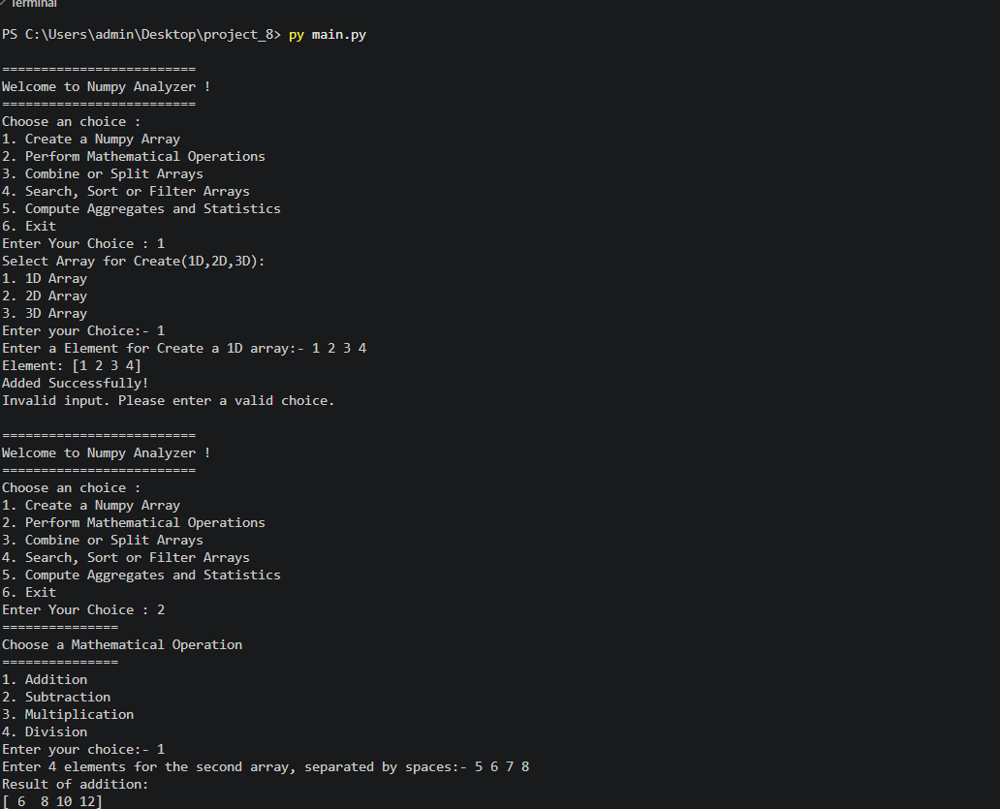

📊 NumPy Analyzer

A menu-driven Python application built using NumPy that allows users to create, manipulate, analyze, and perform mathematical operations on 1D, 2D, and 3D NumPy arrays.

This project demonstrates the practical implementation of NumPy concepts through an interactive console-based application.

🚀 Features
1. Create NumPy Arrays
Create 1D arrays.
Create 2D arrays by specifying rows and columns.
Create 3D arrays by specifying depth, rows, and columns.
Accept user input to populate arrays.
2. Indexing and Slicing
Access individual elements using indexing.
Perform indexing on 1D, 2D, and 3D arrays.
Extract specific portions of arrays using slicing.
3. Mathematical Operations

Perform mathematical operations between two arrays:

Addition (+)
Subtraction (-)
Multiplication (*)
Division (/)
4. Combine and Split Arrays
Combine arrays using NumPy's vstack() function.
Split arrays using NumPy's array_split() function.
5. Search, Sort, and Filter
Search for a specific value using np.where().
Sort array elements using np.sort().
Filter values less than a given number.
Filter values greater than a given number.
6. Aggregate Operations and Statistics

Calculate statistical values using NumPy:

Sum (np.sum())
Mean (np.mean())
Median (np.median())
🛠️ Technologies Used
Python – Programming language.
NumPy – Numerical computing library.
OOP (Object-Oriented Programming) – Class and object-based implementation.
Exception Handling – Handling invalid inputs and runtime errors.
📦 Installation and Setup
Step 1: Clone the Repository
bash
git clone https://github.com/your-username/numpy-analyzer.git

Step 2: Navigate to the Project Directory
bash
cd numpy-analyzer

Step 3: Install NumPy
bash
pip install numpy

Step 4: Run the Program
bash
python main.py

💻 Application Menu

The application provides the following menu:

text
=========================
Welcome to Numpy Analyzer!
=========================

Choose an option:

1. Create a Numpy Array
2. Perform Mathematical Operations
3. Combine or Split Array
4. Search, Sort, or Filter Arrays
5. Compute Aggregates and Statistics
6. Exit

Enter Your Choice:

📁 Project Structure
text
numpy-analyzer/
│
├── main.py
├── README.md
└── output.png

🎯 Learning Objectives

Through this project, I practiced:

Creating and manipulating NumPy arrays.
Understanding 1D, 2D, and 3D arrays.
Working with array indexing and slicing.
Performing mathematical operations on arrays.
Combining and splitting arrays.
Searching, sorting, and filtering data.
Applying aggregate and statistical functions.
Implementing Object-Oriented Programming in Python.
Handling exceptions and user input.
🔮 Future Improvements
Add support for floating-point numbers.
Implement matrix multiplication.
Add transpose and reshape operations.
Improve input validation and error handling.
Add graphical user interface (GUI).
Support saving and loading arrays from files.

## OUTPUT

👨‍💻 Author

**Harshit**